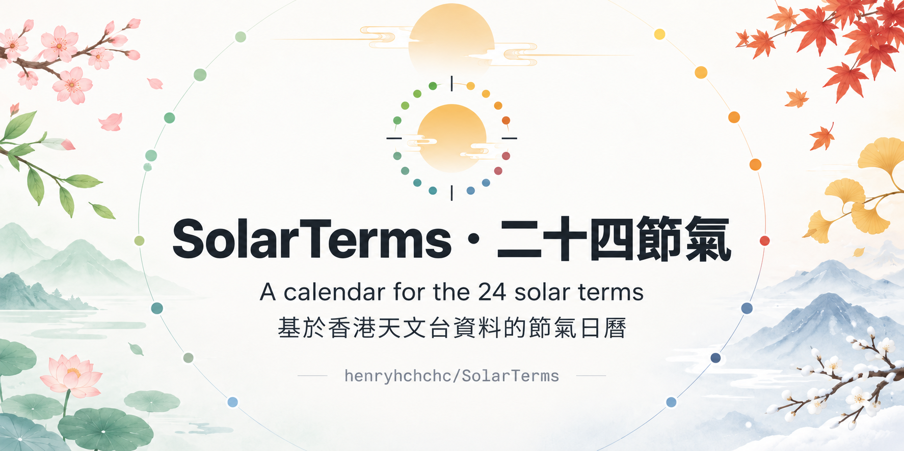

# 🌿 Solar Terms · 二十四節氣



A bilingual calendar of the 24 solar terms, based on [Hong Kong Observatory data](https://www.hko.gov.hk/en/gts/astronomy/Solar_Term.htm).

The 24 solar terms mark the seasons through the Sun's apparent movement across the sky.
Each term begins when the Sun advances another 15° along its annual path, the ecliptic.
The cycle includes the equinoxes, solstices, and the traditional beginnings of spring, summer, autumn, and winter.

Names such as *穀雨 Corn Rain*, *白露 White Dew*, and *驚蟄 Insects Waken* reflect seasonal weather and farming activities in ancient central China.
The terms also help align the traditional Chinese calendar with the solar year: its 12 major terms alternate with 12 minor terms, and a lunar month without a major term becomes a leap month.

[Read more at Hong Kong Observatory](https://www.hko.gov.hk/en/gts/time/24solarterms.htm).

## 📅 Add to your calendar

Copy this URL into your calendar app's **Add calendar by URL** or **Subscribe** option:

```text
https://henryhchchc.github.io/SolarTerms/solar_terms.ics
```

The calendar covers the current Hong Kong year and the following two years.
The feed refreshes on January 1, July 1, and when the project changes.

## ☀️ What's inside

- **Bilingual titles:** Traditional Chinese followed by English, such as `小寒 Moderate Cold`.
- **Hong Kong dates:** All-day events with the exact time (UTC+08:00) in their details.
- **Astronomical background:** Bilingual classifications, solar longitudes, and daylight notes for equinoxes and solstices.

Events leave your day available and include no alarms.
